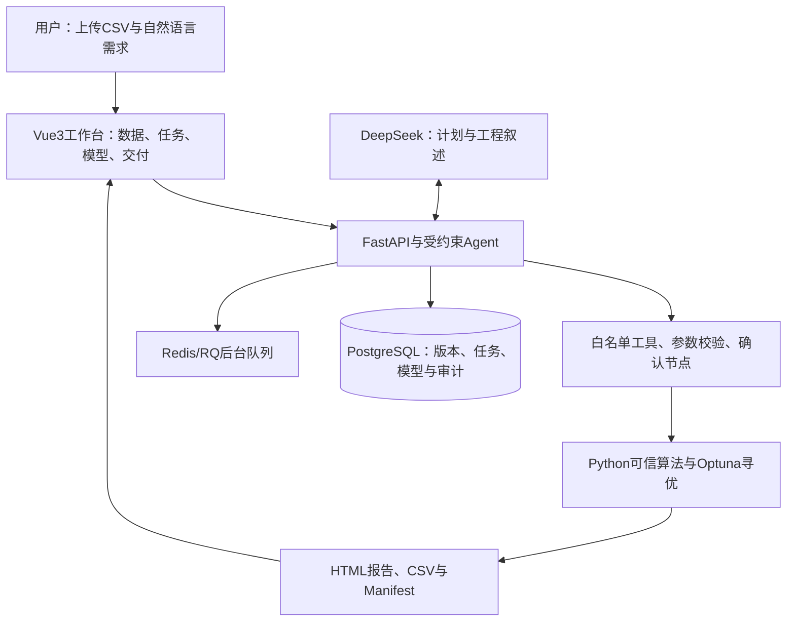
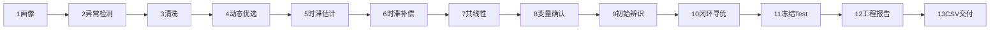
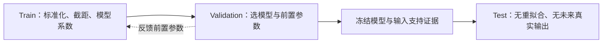

# 可重新绘制的架构与算法示意

以下图是能力和流程概念示意，不能标成真实测量图。可以转成PPT原生形状，并按步骤逐次出现。

## 平台架构

## 真实13步流水线

## D-最优解释图

画3个有重叠的时间窗口，灰色表示已覆盖行、绿色表示新补充行；箭头指向信息矩阵和log-det增量。标签写“质量门控→去重→互补信息→模型验证”。示意目标：Δ(W|S)=log det(M(S∪W)+λI)−log det(M(S)+λI)。不要填入不存在的实际信息增益数值。

## 训练与评价隔离

自由仿真使用预测输出递推；对比一步预测与长期模拟。图中区间长度为概念比例，不代替每个数据集的真实切分。

## 反馈预算

validation_guarded：少于4个Trial不排反馈；先3次搜索，第4次可反馈，以后每4次最多1次反馈；预算≤1/4；最终保留历史最佳冻结模型。本次四次试验赢家第0次，不能画出不存在的持续改善。
