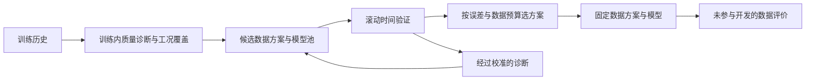

# IndusOpt 下一轮算法改进研究

日期：2026-10-03。依据：当前源代码、上轮 144 组真实过程对照、30 次实际寻优、此次诊断复现和验证集小试验，以及系统辨识原始论文与官方技术资料。

**建议顺序：修正诊断与评价 → 扩展动态模型 → 工况覆盖 → 面向预测效果的数据优选 → 将诊断映射为具体搜索动作。**

本轮新增研究脚本与文档，未修改正式算法。下面明确区分代码中已验证的问题、数据中观察到的现象，以及有待独立实验确认的方案。

## 1. 这次研究新增了哪些证据

### 1.1 诊断误触发是明确问题，应先修复

`optimization_service.py::_feedback_actions` 对 3 个输入各检查 20 个正滞后；任意一次相关性超过 `1.96 / sqrt(n)` 就触发调整。这个界限是单次检验的近似阈值，不是 60 次联合检查的阈值。

用当前相关性计算函数做 500 次空假设复现：3 个输入与残差均为相互独立的高斯噪声，残差长度 200，种子 20261003。**误触发 480 次，比例 96%。** 这不表示真实数据的全部相关性都是假的，但说明现有触发率无法按“95% 置信”解释。上轮 30 次实际寻优全部触发了输入残差相关诊断；当前响应主要是增加片段数，诊断的区分能力很弱。

下一步：为跨通道、跨滞后的检验控制联合误报率，优先验证 Holm 校正或保持时间相关性的块重采样同时置信带；残差自相关另外使用适当的联合检验，并考虑参数估计消耗的自由度。用独立噪声与已知遗漏动态分别检查误报率、检出率。[statsmodels 的 Ljung–Box 接口](https://www.statsmodels.org/dev/generated/statsmodels.stats.diagnostic.acorr_ljungbox.html)可用于自相关检查，但不能直接替代输入与残差的独立性检验。

### 1.2 仿真数值保护仍会读取未来目标

`validation.py::free_run_simulate` 用整条输出的最大绝对值确定截断边界。一个极端但稳定的模型复现中，仅把索引 160 以后的输出由 1 改成 1000，索引 80–120 的同一次仿真首个预测就从 1000 变成 1000000。

这是明确的未来数据依赖，只有数值截断触发时才改变预测。**不能据此推断上一轮正常模型的成绩已经被影响。** 下一步应从训练阶段固定数值保护尺度，或将越界标记为仿真失败；加入“改变未来输出不改变既有预测和验证评分”的性质测试。验证 FIT 的 -100 下限也应只用于展示，保留原始误差用于排名。

### 1.3 模型搜索范围值得扩大

当前 60 个候选都是 ARX，`na ∈ {1,2,3,4}`，各通道 `nb ∈ {1,2,3}`。上轮 144 个胜出配置中，**105 个至少有一个阶次达到上限**；全量训练的 24 个配置中有 18 个达到上限。

这支持扩大搜索范围的假设，但不能单凭触顶证明欠拟合。ARX 本身通过递归表达长响应，并不是只能记忆四个采样点。

本次额外做了只使用 Train/Validation 的试验：保持同一全量训练、通道时滞和 32 行间隔，先比较原候选，再加入低阶 `alpha=10` 的 Ridge，最后加入最高 `na=12、nb=12` 的 Ridge。每个输出有 120 次候选尝试，包含部分重复配置；所有候选仍要求稳定。调用拟合前将末尾 Test 输入和输出置零，**没有计算新增模型的 Test 指标**。

| 数据/输出 | 原候选按 RMSE 选优 | 低阶加入更强 Ridge | 扩阶后验证 RMSE | 相对低阶强 Ridge 改善 |
|---|---:|---:|---:|---:|
| dryer2/dry_bulb_temperature | 2.0508 | 2.0508 | 2.0401 | 0.5% |
| dryer2/wet_bulb_temperature | 0.4947 | 0.4947 | 0.4947 | 0.0% |
| dryer2/raw_material_moisture | 0.8229 | 0.8229 | 0.8229 | 0.0% |
| evaporator/product_dry_matter | 0.5893 | 0.5893 | 0.4991 | 15.3% |
| evaporator/product_flow | 0.5742 | 0.5742 | 0.4183 | 27.1% |
| evaporator/product_temperature | 0.5144 | 0.4994 | 0.4403 | 11.8% |
| glassfurnace/temperature_sensor_1 | 0.8520 | 0.8520 | 0.8309 | 2.5% |
| glassfurnace/temperature_sensor_2 | 0.7959 | 0.7959 | 0.7871 | 1.1% |
| glassfurnace/temperature_sensor_3 | 0.7938 | 0.7938 | 0.7852 | 1.1% |
| glassfurnace/temperature_sensor_4 | 0.2839 | 0.2839 | 0.2418 | 14.8% |
| glassfurnace/temperature_sensor_5 | 0.6439 | 0.6167 | 0.5250 | 14.9% |
| glassfurnace/temperature_sensor_6 | 0.4904 | 0.4725 | 0.4556 | 3.6% |

扩大候选后在 10/12 个输出上得到更低的验证 RMSE，蒸发器产品流量下降约 27.1%。但更大的候选集本来就更容易找到低验证误差；这还不是泛化提升的证明。干燥机两个输出没有改善，也说明仅扩大阶次不足以解决全部问题。

### 1.4 数据分布和模型迁移也需要处理

按 60% 训练、20% 验证、20% Test 并保留原间隔划分，干燥机干球温度的验证、测试均值分别比训练均值高约 **2.56、2.37 个训练标准差**。这是输出分布偏移的证据；原因可能是输入工况变化、过程动态变化或遗漏扰动，不能只凭均值断定过程参数发生了变化。

玻璃炉温度传感器 2 与 3 在训练区间的相关系数约为 0.99968。多个输出共享装置与采样过程，因此 12 个输出不能当成 12 个独立工厂，更不能把 144 行对照当成 144 次独立试验。

## 2. 优先扩展哪些模型

| 顺序 | 方法 | 解决的候选问题 | 实施要点与边界 |
|---|---|---|---|
| 第一批 | 较高阶正则化 ARX | 当前阶次空间过窄 | 阶次与正则强度联合选择；不直接把最大阶次改成默认值 |
| 第一批 | 正则化 FIR，采用 TC/DC 或稳定样条核 | 用有限冲激响应表达较长动态，控制高维估计方差 | 从较短长度开始；核结构鼓励响应衰减与相关性；正则化方法应有自己的样本数要求，不能照搬 OLS 的秩门槛 |
| 第二批 | OE，必要时 BJ | 拟合的一步误差与交付的自由仿真目标不一致；过程和扰动需要分开描述 | OE 优化输入到输出的动态响应；BJ 单独描述过程与噪声；需要可靠初值、稳定性约束和失败记录 |
| 第二批 | 状态空间/子空间辨识 | 多变量、共享动态、模型阶次和噪声耦合 | 先做单输出可比基线，再验证多输出共享状态；处理初始状态；未确认开环/闭环采集方式时，不宣称普通 N4SID 无偏 |
| 条件触发 | 分工况模型或低复杂度非线性模型 | 线性模型在多个验证时段持续出现结构性残差 | 先用证据区分工况差异与非线性；局部模型数据不足时退回全局模型 |

ARX 的过程传递函数和噪声模型共享分母；Ridge 与 Huber 改变估计方式，不能解除这项结构限制。[MathWorks 模型排障说明](https://www.mathworks.com/help/ident/ug/troubleshooting-models.html)明确讨论了这一点。

正则化 FIR 的依据是 Chen、Ohlsson、Ljung（2012）的 [Automatica 原文](https://www.diva-portal.org/smash/get/diva2:556599/FULLTEXT01.pdf)，不是简单给高阶系数加同一个惩罚。其研究比较了利用冲激响应结构的正则化方法；对本项目是否更好仍需验证。[官方 arxRegul 选项](https://www.mathworks.com/help/ident/ref/arxreguloptions.html)列出了 TC、DC、稳定样条等核。

OE/BJ 和状态空间用于不同假设；不要统一用残差白噪声比例惩罚所有模型。OE 和工具变量方法主要关注过程动态，其残差自相关不应按 ARX 的同一规则解释。[残差分析说明](https://www.mathworks.com/help/ident/ug/what-is-residual-analysis.html)区分了这些情况。[N4SID 选项](https://www.mathworks.com/help/ident/ref/n4sidoptions.html)也区分预测与仿真目标，以及适用于闭环数据的特定加权方法。

## 3. 将“高信息量选段”改成“满足建模需求的省数据方案”

当前 D-最优使用回归特征的信息矩阵；它与最终自由仿真误差之间有模型与噪声假设。多个 ARX 结构的 log-det 平均仍然是代理目标，不能保证未知工况的预测最优。

建议先建立两级方案：

1. **保证覆盖。** 训练区间内按输入水平、变化速率、输出响应和局部动态特征识别候选工况；为持续工况和过渡过程保留最低覆盖。正常设定值切换不能自动归为坏数据；候选需包含足够的前置历史与后续响应。
2. **在覆盖约束下节省数据。** 同时保留能量、随机连续段、D-最优和预测方差代理等方案，让内部时间验证选择。多尺度窗口成本用新增唯一训练行计算，比较单位成本的边际收益；不能把等窗口数当作等数据量，也不能未经证明宣称基数约束下的近似保证适用于重叠行预算。

值得试验的方向是 V-最优：在固定线性/贝叶斯近似下，用参考工况上的预测方差作为代理，例如 `trace(C_ref · M_selected^-1)`。`C_ref` 只能来自训练历史或任务明确允许的工况资料，不能偷看 Test 输出；随后仍以时间验证的真实模拟误差验收。这个近似不能直接等同于非线性自由仿真的误差保证。预测误差与实验设计目标的关系可参考 [Dereziński 等，COLT 2019](https://proceedings.mlr.press/v99/derezinski19b.html)。

工况切分也需要最小持续长度和惩罚项。可先以局部动态拟合变化为候选证据；[ruptures 的 CostAR](https://centre-borelli.github.io/ruptures-docs/user-guide/costs/costautoregressive/)提供了自回归系数变化的成本示例，但该现成实现限于一维输出，不能直接当作多输入 ARX 工况识别器。

**评价目标应同时包含数据量和误差。** 目前多尺度多结构方案约使用 24% 训练行，中位误差比全量高 4.1%，这可能是有价值的压缩取舍。但只有 12/24 个组合落在全量误差的 +5% 内，最差约高 50.9%，因此不能只报告中位数。

下一轮报告 10%、25%、50%、100% 预算曲线，在候选模型和训练范围相同时比较。若将“误差增加不超过 5%”设为初始业务容忍值，应明确它是待确认的设计目标；选出达到容忍值的最小数据集，并同时展示最差工况。不要把“必须胜过全量”当成数据压缩唯一的成功定义。

## 4. 先重构评价，再继续增加搜索次数

- 在开发数据中做 3–5 个可容纳历史长度的滚动时间切分；短序列减少折数或候选长度。每折独立拟合预处理、质量统计、时滞候选和选段策略，不能从整段数据提前算一次。
- 明确评测允许的历史上下文和间隔，所有候选使用共同可评分区间。长历史模型不能悄悄拿更少、更容易的验证点来比较。
- 主要比较多折自由仿真 NRMSE 与最差折；增加若干与用途匹配的有限步预测指标，说明未来输入是否已知。有限步滚动重启与整段自由仿真应分开报告。
- 稳定性与已知物理约束作为准入条件；误差足够接近时再选更简单、更省数据的模型。残差诊断按模型类别解释，避免一个主观总分掩盖误差与复杂度之间的取舍。
- 标准化只学习训练统计；使用时间块或装置层面的配对评估，避免将相邻样本、相似传感器当成独立重复。
- 三套现有数据已经参与了方法开发，应作为开发与回归数据。对最终推广结论使用另取的、未参与方案调整的过程记录；不能把已经查看过的旧 Test 重新命名为全新盲测。

[TimeSeriesSplit 官方说明](https://scikit-learn.org/stable/modules/generated/sklearn.model_selection.TimeSeriesSplit.html)提供了按时间增长的训练划分与 gap 的基础实现。[Han、Huang、Wang，ICML 2024](https://arxiv.org/html/2402.08672v2)研究了时间分布变化下的自适应滚动评价；可以借鉴其窗口选择思想，但论文中的独立批次与有界损失假设并不自动适用于工业动态序列，不能直接引用其保证。

回看既有结果，如果每个输出/划分按记录中的 Validation 分数从六种方案中选一个，有 16/24 个组合的 Test RMSE 低于全量，4 个相同，误差比中位数约 0.971。**这是事后分析，支持继续研究方案选择，不是新的独立验证。**

## 5. 让诊断反馈有不同的动作

| 经过校准的证据 | 应生成的候选动作 | 如何接纳 |
|---|---|---|
| 输入与残差仍有关联 | 扩展相应通道的时滞/动态阶次，比较不同过程模型 | 新时间验证窗口的预测/仿真误差改善 |
| 残差持续有色，且模型包含噪声解释任务 | 比较 ARMAX/BJ/创新状态空间噪声模型 | 检查噪声诊断与目标误差；不对 OE 生搬规则 |
| 系数对训练片段很敏感 | 加强正则化、减少冗余变量或扩大覆盖 | 参数与误差在时间切分上更稳定 |
| 某类工况误差显著偏大 | 增加该工况的代表片段，或比较局部模型 | 最差工况改善，其他工况没有不可接受退化 |
| 数据本身缺少有效激励 | 提示需要新的、有针对性的观测或实验 | 已有数据不足时允许返回“证据不足” |

DeepSeek 可以解释证据、提出白名单内的下一步动作和生成报告；数值参数仍由实际求解器估计，候选是否接受由固定评价流程决定。每次记录触发证据、动作、新增成本和前后验证结果。当前数据量和实验结果还不足以支持把 Transformer 或强化学习调参设为下一轮主线。

## 6. 实施顺序与验收

| 优先级 | 交付 | 验收依据 |
|---|---|---|
| P0 | 联合误报控制、仿真未来依赖修复、原始误差保留 | 空假设下的误报率与置信区间；正例检出率；改变未来数据不改变已有预测 |
| P1 | 可复用的时间验证协议；高阶正则 ARX 与正则 FIR | 多折对照，等预算；小试验收益能否在新的时间块复现 |
| P2 | OE/BJ/状态空间模型适配器与模型格式 | 拟合、一步/多步预测、自由仿真、持久化回放均一致；旧 ARX 仍可加载 |
| P3 | 工况覆盖、预测方差选段、数据量—误差曲线 | 相对能量与随机连续段的稳定收益；最差工况和小预算失败均公开 |
| P4 | 多动作诊断反馈与可追溯解释 | 与无反馈搜索比较，同预算下是否更快达到合格结果 |

第一轮实际改动建议只做 P0 与 P1。确认模型能力和评价方法后，再判断 P2/P3 哪项收益更大。



## 7. 可复现证据

- `diagnostics.json` 保存触顶统计、随机噪声误触发实验、未来截断复现、分区均值偏移、事后策略比较及 12 个输出的验证集小试验。
- 复现脚本：`backend/scripts/research_algorithm_roadmap.py`，不修改正式算法。
- 本次没有重算或替换上一轮正式 Test 成绩，也没有把小试验模型发布为新默认。

在 `backend/` 执行：

```bash
.venv/bin/python scripts/research_algorithm_roadmap.py --data-dir ../../公开工业数据集/DaISy --results ../docs/experiments/real-process-20261003/final/results.json --out ../docs/research/algorithm-roadmap-20261003/diagnostics.json
```


## P0 / P1 实施记录

已实现联合输入—残差检验、独立于未来输出的仿真、原始FIT、滚动验证、高阶Ridge ARX和TC FIR。正式诊断也已改为保存参数回放。详见[修复与实测报告](../../experiments/real-process-20261003/repair/report.md)。本轮模型对照9/12输出改善，中位RMSE比0.9139；完整寻优的干燥机首个输出仍未解决，P2–P4保持待研究。
